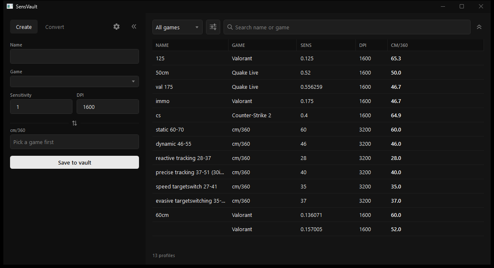
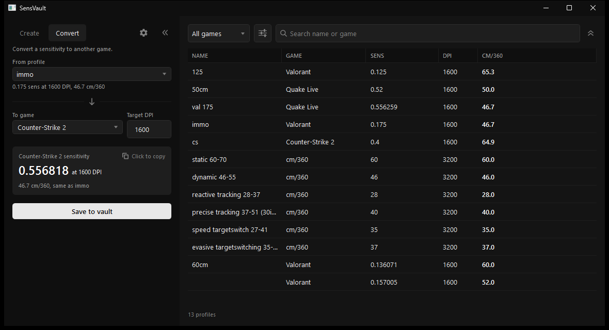

# SensVault

An easy place to store your mouse sensitivities across a library of games.

**[Download](https://github.com/as9pa/sensvault/releases/latest)** (Windows x64)

## What it does

- **Vault:** save a sensitivity per game, with its DPI and cm/360.
- **Sorting:** sort by name, game, sens, DPI or cm/360.
- **Search:** filter the vault, with a clear button.
- **Convert:** turn a sensitivity into another game's, from a profile.
- **Copy and paste:** copy whole rows and paste them back in.
- **Row actions:** rename, duplicate or delete, with Ctrl+Z to undo.
- **Themes:** pick one and it is saved with your vault.
- **Saved for you:** data lives in `%APPDATA%\SensVault\data.json`.

## Download

Requires Windows x64.

| [Releases](https://github.com/as9pa/sensvault/releases) | Size    | Needs .NET?                                                                 |
| ------------------------------------------------------- | ------- | --------------------------------------------------------------------------- |
| `sensvault-v0.3.0-win-x64.exe`                          | ~62 MB  | No, the runtime is inside                                                   |
| `sensvault-v0.3.0-win-x64-dotnet.zip`                   | ~120 KB | Yes, [.NET 10 Desktop Runtime](https://dotnet.microsoft.com/en-us/download) |

Take the `.exe` unless you already have .NET installed.

## Build

Needs the .NET 10 SDK.

    dotnet build
    dotnet run

Release builds are made with `dotnet publish -c Release -r win-x64 -p:PublishSingleFile=true`,
with `--self-contained true` for the `.exe` and `--self-contained false` for the `-dotnet.zip`.

## License

MIT. See [LICENSE](LICENSE).
